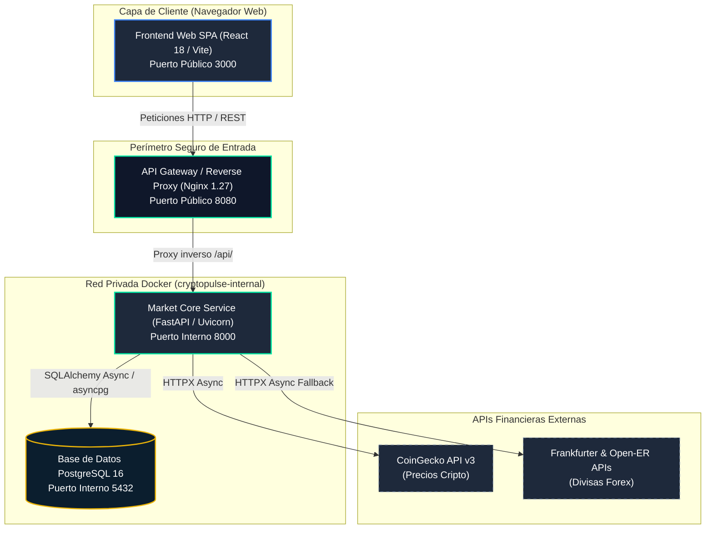
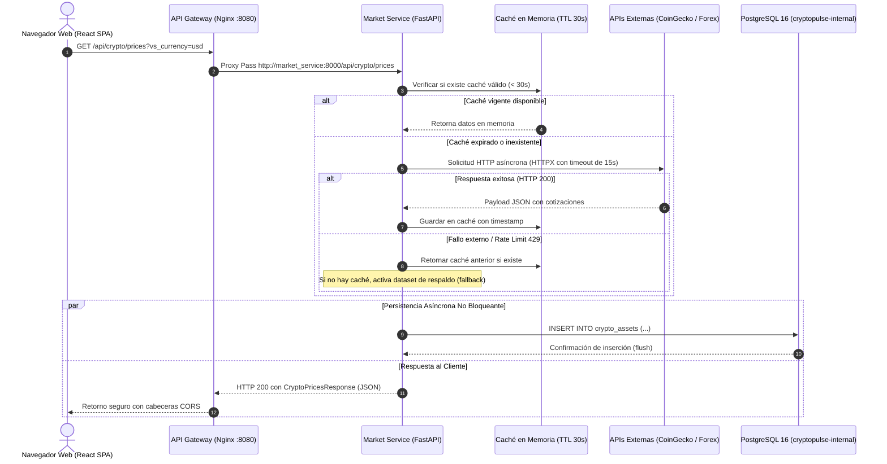

# Arquitectura del Sistema — CryptoPulse

Este documento describe de manera exhaustiva la arquitectura de software, los componentes de infraestructura, los flujos de datos y los mecanismos de resiliencia implementados en **CryptoPulse**.

---

## 1. Visión General del Sistema

**CryptoPulse** es una plataforma distribuida de inteligencia financiera y seguimiento de activos en tiempo real. Su propósito es consolidar cotizaciones de criptomonedas y tasas de cambio internacionales (Forex), ofreciendo herramientas interactivas de análisis financiero, conversión de divisas, seguimiento de portafolios y monitoreo continuo de infraestructura.

### Principios de Diseño
* **Arquitectura de Microservicios:** Separación estricta de responsabilidades entre presentación, pasarela de enlace, lógica de negocio y persistencia.
* **Perímetro Seguro:** Aislamiento de capas mediante redes privadas virtuales de Docker; ningún servicio de backend ni base de datos expone puertos hacia la máquina anfitriona (*host*).
* **Persistencia Transaccional No Bloqueante:** Persistencia asíncrona en base de datos relacional (PostgreSQL) con tolerancia a fallos garantizada.
* **Alta Disponibilidad y Resiliencia:** Estrategia multinivel de mitigación (caché en memoria con TTL, conmutación por error híbrida entre APIs y conjuntos de datos de contingencia) para asegurar operación 24/7.

---

## 2. Diagrama de Arquitectura Global



---

## 3. Descripción de Componentes

### 3.1. Frontend Web SPA (`frontend/`)
* **Tecnología:** React 18, Vite 5, JavaScript moderno (ES Modules) y CSS nativo con diseño *glassmorphism* y modo oscuro.
* **Servidor en Contenedor:** Nginx 1.27 Alpine en esquema de despliegue multi-stage (Node.js 20 para compilar `dist/` y Nginx para servir estáticos).
* **Módulos y Vistas:**
  * **Mercados Cripto:** Tabla interactiva en vivo con búsqueda, filtros por tendencia (ganadores, perdedores, top 5), ordenamiento multidimensional, gráficos de sparkline de 7 días y modal de ficha técnica detallada.
  * **Conversor Global:** Calculadora instantánea bidireccional entre cualquier par de criptomonedas y divisas fiat (USD, COP, EUR, GBP, MXN, BRL, JPY).
  * **Tasas Forex:** Matriz de tipos de cambio en vivo con soporte de selección de moneda base y cálculo automático de tasas directas e inversas.
  * **Portafolio Personal:** Administrador de posiciones de inversión con cálculo de valor de mercado en tiempo real, Ganancias y Pérdidas (P&L), persistencia en almacenamiento local (*localStorage*) y exportación de datos a formato CSV.
  * **Calculadora ROI:** Simulador de interés compuesto con ajuste de capital inicial, tasa anual proyectada (APY), frecuencia de capitalización y horizonte temporal.
  * **Diagnóstico de Infraestructura:** Panel modal que ejecuta comprobaciones de latencia y estado en tiempo real sobre todos los servicios del sistema.

### 3.2. API Gateway (`gateway/`)
* **Tecnología:** Nginx 1.27 Alpine configurado como proxy inverso de alto rendimiento.
* **Responsabilidades:**
  * **Punto Único de Entrada (*Single Point of Entry*):** Atiende en el puerto 8080 y encamina el tráfico de `/api/` hacia `market-service:8000` en la red privada interna.
  * **Seguridad y Aislamiento:** Impide el acceso directo no autorizado a los contenedores internos desde fuera del entorno de Docker.
  * **Gestión de CORS y Headers:** Configuración centralizada de cabeceras de control de acceso (`Access-Control-Allow-Origin`, `Methods`, `Headers`) y respuesta a solicitudes de verificación preliminar (*preflight OPTIONS*).
  * **Sondeo de Salud Propio:** Expone el endpoint `/gateway/health` con tiempo de respuesta local sin sobrecargar el backend.

### 3.3. Market Core Service (`services/market-service/`)
* **Tecnología:** Python 3.12, FastAPI 0.115, servidor ASGI Uvicorn 0.30 y cliente HTTP asíncrono HTTPX.
* **Estructura Modular:**
  * `app/main.py`: Punto de arranque de la aplicación, configuración de ciclo de vida (*lifespan*) con reintentos de inicialización para PostgreSQL, middlewares y documentación automática interactiva Swagger (`/api/docs`).
  * `app/config.py`: Gestión tipada de variables de entorno mediante Pydantic Settings con patrón singleton (`@lru_cache`).
  * `app/database.py`: Creación del motor asíncrono `create_async_engine`, factory de sesiones `async_sessionmaker` y función generadora `get_db` para inyección de dependencias.
  * `app/models.py`: Modelos declarativos SQLAlchemy mapeados a tablas de PostgreSQL.
  * `app/schemas.py`: Modelos Pydantic para validación de datos de entrada y serialización de respuestas JSON.
  * `app/routers/`: Controladores divididos por dominio (`crypto.py`, `forex.py`, `health.py`).
  * `app/services/`: Clientes de integración externa (`coingecko.py`, `frankfurter.py`).

### 3.4. Base de Datos Relacional (`postgres`)
* **Tecnología:** PostgreSQL 16 Alpine con almacenamiento persistente montado en un volumen administrado de Docker (`postgres_data`).
* **Tablas Principales:**
  * `crypto_assets`: Histórico de cotizaciones de criptomonedas (identificador, símbolo, nombre, precio actual, capitalización de mercado, cambio en 24h, volumen total, URL de icono y marcas de tiempo).
  * `forex_rates`: Histórico de tasas de cambio de divisas (moneda base, moneda objetivo, tasa de conversión y marcas de tiempo).
  * `health_logs`: Registro de comprobaciones de disponibilidad, latencias y errores de conectividad de los componentes del sistema.

---

## 4. Flujo de Datos y Ciclo de Petición

El siguiente diagrama ilustra la interacción paso a paso cuando un usuario consulta cotizaciones:



---

## 5. Topología de Redes Docker y Seguridad

El entorno está orquestado mediante `docker-compose.yml` dividiendo los contenedores en dos redes virtuales con controladores tipo *bridge*:

| Red Docker | Tipo | Contenedores Miembro | Puertos Expuestos al Host | Propósito |
|---|---|---|---|---|
| `cryptopulse-public` | Pública / Externa | `frontend`, `gateway` | `3000` (Frontend), `8080` (Gateway) | Permitir acceso directo del usuario desde su navegador web. |
| `cryptopulse-internal` | Privada / Aislada | `gateway`, `market-service`, `postgres` | **Ninguno (0 puertos al host)** | Contener de forma hermética la lógica transaccional y los datos. |

### Reglas de Seguridad Implementadas:
1. **Aislamiento Total de PostgreSQL:** El puerto 5432 no está expuesto en la máquina host; únicamente los contenedores dentro de `cryptopulse-internal` pueden resolver el nombre DNS `postgres` y conectarse.
2. **Aislamiento del Backend:** El puerto 8000 de FastAPI no es accesible directamente desde el exterior; cualquier interacción pasa forzosamente por Nginx Gateway.
3. **Conectividad de Salida:** Los contenedores en la red interna tienen acceso de egreso a Internet para consultar las APIs financieras externas a través de la interfaz NAT de Docker.

---

## 6. Mecanismos de Resiliencia y Tolerancia a Fallos

1. **Mitigación de Rate Limiting (CoinGecko):**
   * Las APIs gratuitas aplican límites de peticiones por minuto (*HTTP 429 Too Many Requests*).
   * Se cuenta con un caché en memoria con ventana de 30 segundos. Si la API externa responde 429 o expira el tiempo límite, se sirven los últimos datos válidos en caché marcados con `"source": "coingecko-cached"`.
2. **Estrategia Híbrida Multi-Fuente para Divisas (Forex):**
   * Las consultas se envían prioritariamente a Frankfurter API.
   * Si la moneda solicitada no está soportada (como COP) o hay falla de conexión, se recurre automáticamente a Open-ER API (`https://open.er-api.com/v6/latest`).
   * Si ambos servicios fallan, se aplica un conjunto de datos de referencia fija para evitar el error 502 al usuario.
3. **Persistencia No Bloqueante en Base de Datos:**
   * La operación de guardado en PostgreSQL dentro de los endpoints `/prices` y `/rates` está encapsulada en bloques `try/except`. Si la base de datos presenta lentitud o desconexión, la petición HTTP responde al cliente sin interrupción.
4. **Ciclo de Reintentos en el Inicio (*Startup Retry Mechanism*):**
   * Al iniciar el contenedor de FastAPI, la función `lifespan` ejecuta hasta 10 intentos con pausa de 2 segundos para esperar a que PostgreSQL complete su inicialización interna.

---

## 7. Catálogo de Endpoints de la API

Accesibles a través de la pasarela en `http://localhost:8080`:

### Criptomonedas
| Método | Ruta | Parámetros de Consulta | Descripción |
|---|---|---|---|
| `GET` | `/api/crypto/prices` | `vs_currency` (usd/eur/cop), `per_page` (1-50) | Cotizaciones actuales con caché y guardado en PostgreSQL |
| `GET` | `/api/crypto/history` | `limit` (1-100), `symbol` (ej: BTC, ETH) | Consulta de precios históricos almacenados en base de datos |

### Tasas de Cambio (Forex)
| Método | Ruta | Parámetros de Consulta | Descripción |
|---|---|---|---|
| `GET` | `/api/forex/rates` | `base` (ej: USD, EUR, COP), `targets` (separados por coma) | Tasas de cambio en vivo con soporte híbrido de proveedores |
| `GET` | `/api/forex/history` | `base` (ej: USD), `limit` (1-100) | Historial de tasas de cambio persistidas en base de datos |

### Diagnóstico de Infraestructura y Salud
| Método | Ruta | Descripción |
|---|---|---|
| `GET` | `/gateway/health` | Estado del Nginx Reverse Proxy (Gateway) |
| `GET` | `/api/health` | Estado del Market Core Service (FastAPI) |
| `GET` | `/api/health/database` | Comprobación de conectividad y latencia con PostgreSQL (`SELECT 1`) |
| `GET` | `/api/health/coingecko` | Comprobación de conectividad con CoinGecko API |
| `GET` | `/api/health/forex` | Comprobación de conectividad con proveedores de Forex |
| `GET` | `/api/health/full` | Reporte integral consolidado de todos los componentes del sistema |
| `GET` | `/api/docs` | Interfaz interactiva de documentación Swagger UI (OpenAPI 3.0) |

---

## 8. Despliegue y Ejecución

```bash
# 1. Iniciar todos los servicios en segundo plano con reconstrucción de imágenes
docker compose up --build -d

# 2. Inspeccionar estado de los contenedores y healthchecks
docker compose ps

# 3. Visualizar logs consolidados en tiempo real
docker compose logs -f

# 4. Detener la plataforma preservando datos en volúmenes
docker compose down
```
