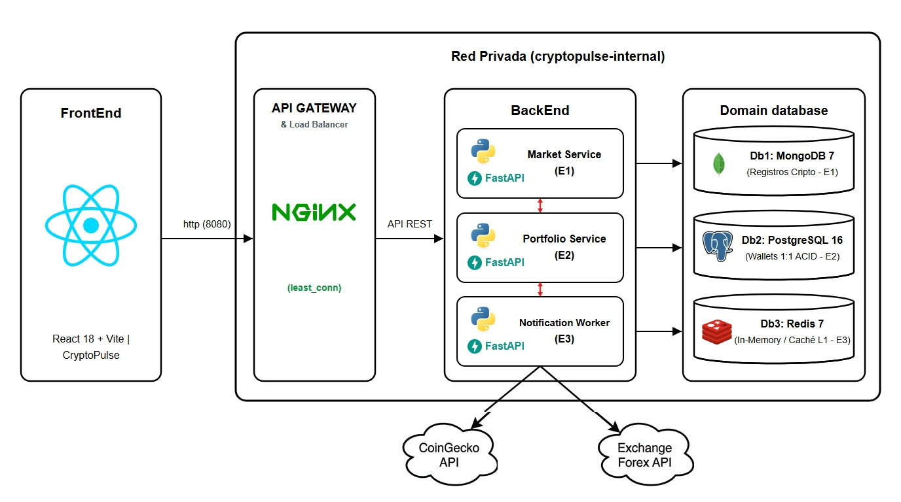

# CryptoPulse

**Plataforma de inteligencia financiera, seguimiento de cotizaciones en tiempo real y prototipo de billetera (*wallet*) con simulación de inversiones**, construida con arquitectura modular de microservicios, clúster con balanceo de carga en Nginx (*least_conn*) y persistencia políglota (*Database-per-Service*).

> Para consultar el detalle exhaustivo del diseño técnico, modelos relacionales/documentales y diagramas de flujo, consulta: **[ARQUITECTURA.md](ARQUITECTURA.md)** o **[docs/ARQUITECTURA.md](docs/ARQUITECTURA.md)**.

---

## Arquitectura del Sistema



```
+-------------+     HTTP 8080     +----------------------+     +-------------------------------------------------------------+
|             |  -------------->  |     API GATEWAY      |     |                   RED PRIVADA DOCKER                        |
|   Frontend  |                   |   & LOAD BALANCER    |     |  +--------------------+  REST  +-------------------------+  |
|  (React 18  |  <--------------  |       (Nginx)        |---->|  |   CLÚSTER MARKET   |<=====>|    CLÚSTER PORTFOLIO    |  |
|   + Vite)   |    Puerto 3000    | least_conn / DoS-Rate|     |  | (Réplicas M1, M2)  |        | (Réplicas P1, P2)        |  |
|             |                   |     Puerto 8080      |     |  +---------+----------+        | * JWT Auth (Bcrypt)      |  |
+-------------+                   +----------------------+     |            |                   | * Wallets 1:1 Aisladas   |  |
                                                               |            v (Ticks)           +------------+------------+  |
                                                               |  +--------------------+                     |               |
                                                               |  | Db1: MongoDB 7     |                     v (ACID Ledger) |
                                                               |  | (Documental)       |        +-------------------------+  |
                                                               |  +--------------------+        | Db2: PostgreSQL 16      |  |
                                                               |            ^                   | (Relacional)            |  |
                                                               |            |   Caché L1 (TTL)  | * Wallets Privadas      |  |
                                                               |            +---------+         +-------------------------+  |
                                                               |                      |                      ^               |
                                                               |                      v                      |               |
                                                               |            +-------------------------+      | Eventos       |
                                                               |            | Db3: Redis 7            |      v               |
                                                               |            | (In-Memory)             |<-----+               |
                                                               |            | * Caché L1 (30s)        |                      |
                                                               |            | * Colas FIFO & PubSub   |                      |
                                                               |            +-------------------------+                      |
                                                               |                      ^                                      |
                                                               |                      |                                      |
                                                               |            +---------+---------------+                      |
                                                               |            | Notification Worker     |                      |
                                                               |            | (FastAPI / Redis)       |                      |
                                                               |            +-------------------------+                      |
                                                               +-------------------------------------+-----------------------+
                                                                                                     |
                                                                                          +----------v----------+
                                                                                          |    APIs EXTERNAS    |
                                                                                          |  * CoinGecko API    |
                                                                                          |  * Exchange Forex   |
                                                                                          +---------------------+
```

### Componentes de la Plataforma

| Componente | Rol / Responsabilidad | Tecnología | Puerto | Política de Escalado |
|---|---|---|---|---|
| **Frontend Web** | SPA con Auth, billetera privada, simulador y conversor | React 18 + Vite | 3000 (público) | 1 contenedor |
| **API Gateway & Load Balancer** | Balanceo de carga `least_conn`, Rate Limiting DoS y proxy inverso | Nginx 1.27 Alpine | 8080 (público) | 1 balanceador perimetral |
| **Market Service Clúster** | Ingesta de cotizaciones, Circuit Breaker y caché L1 | FastAPI (Python 3.12) | 8000 (privado) | 2 réplicas balanceadas (`M1`, `M2`) |
| **Portfolio & Auth Clúster**| Usuarios, JWT, billeteras 1:1 aisladas y simulaciones | FastAPI (Python 3.12) | 8001 (privado) | 2 réplicas balanceadas (`P1`, `P2`) |
| **Notification Worker**| Despacho asíncrono de alertas de volatilidad y órdenes | FastAPI + Redis Worker | 8002 (privado) | 1 worker asíncrono |
| **Db1: MongoDB 7** | **Documental:** Registros de cambios e histórico de precios | MongoDB 7.0 | 27017 (privado)| Aislado en red interna |
| **Db2: PostgreSQL 16** | **Relacional:** Usuarios, billeteras aisladas y libro mayor | PostgreSQL 16 Alpine | 5432 (privado) | Aislado en red interna |
| **Db3: Redis 7** | **In-Memory:** Caché distribuido L1 y colas de eventos | Redis 7 Alpine | 6379 (privado) | Aislado en red interna |

---

## Inicio Rápido

### Prerrequisitos
- Docker Desktop instalado y en ejecución

### Levantar el Clúster Completo con Docker Compose

```bash
# Navegar al directorio del proyecto
cd cryptopulse

# Levantar todos los microservicios, réplicas y bases de datos
docker compose up --build -d

# Verificar el estado y healthchecks de todos los contenedores
docker compose ps
```

### URLs de Acceso

| URL | Descripción |
|---|---|
| **http://localhost:3000** | Plataforma Web Operativa (Mercados, Login/Registro y Billetera Privada) |
| **http://localhost:8080/api/docs** | Documentación Swagger UI del clúster |
| **http://localhost:8080/gateway/health** | Estado de salud del Gateway y Load Balancer |
| **http://localhost:8080/api/health/full** | Diagnóstico integral consolidado de infraestructura y bases de datos |

### Detener los servicios

```bash
docker compose down
```

---

## Catálogo de Endpoints de la API

Accesibles a través del Load Balancer en `http://localhost:8080`:

### 1. Autenticación y Billeteras Aisladas (Portfolio Clúster — PostgreSQL 16)
| Método | Ruta | Descripción |
|---|---|---|
| `POST` | `/api/auth/register` | Registro de usuario con asignación automática de wallet personal ($10,000 USD virtual) |
| `POST` | `/api/auth/login` | Autenticación de credenciales y emisión de token JWT Bearer |
| `GET` | `/api/auth/me` | Consulta del perfil autenticado con verificación de token |
| `GET` | `/api/wallet/my-wallet` | Consulta de la billetera exclusiva del usuario autenticado (estrictamente no compartida) |
| `POST` | `/api/wallet/simulate/order` | Ejecución de simulación de compra/venta a precio real de mercado con transaccionalidad ACID |
| `GET` | `/api/wallet/my-orders` | Historial inmutable de órdenes de inversión simuladas del usuario |

### 2. Criptomonedas (Market Clúster — MongoDB 7 + Redis L1)
| Método | Ruta | Descripción |
|---|---|---|
| `GET` | `/api/crypto/prices?vs_currency=usd&per_page=10` | Precios en vivo con caché en Redis L1 (< 3ms) y persistencia de ticks en MongoDB |
| `GET` | `/api/crypto/history?limit=20&symbol=BTC` | Historial de variaciones consultado directamente desde MongoDB 7 |

### 3. Tasas de Cambio Forex (Market Clúster — MongoDB 7)
| Método | Ruta | Descripción |
|---|---|---|
| `GET` | `/api/forex/rates?base=USD&targets=COP,EUR,GBP` | Tasas en vivo con conmutación por error híbrida |
| `GET` | `/api/forex/history?base=USD&limit=20` | Historial de tasas de cambio persistido en MongoDB 7 |

### 4. Alertas y Notificaciones (Notification Worker — Redis 7)
| Método | Ruta | Descripción |
|---|---|---|
| `GET` | `/api/notifications?limit=20` | Consulta de notificaciones y alertas encoladas para la campana del Navbar |
| `POST` | `/api/notifications/events` | Encolado de eventos asíncronos en Redis 7 (órdenes y alertas) |
| `POST` | `/api/notifications/test` | Disparador de notificaciones de prueba para demostraciones en vivo |
| `DELETE`| `/api/notifications` | Limpieza del buffer de notificaciones |
| `GET` | `/api/notifications/health` | Estado del worker y latencia con Redis |

---

## Orquestación del Clúster

El proyecto soporta **dos modalidades de orquestación industrial**:

1. **Docker Compose de Alta Disponibilidad (HA):**
   - Ejecución guiada mediante el script PowerShell: `.\orchestrate.ps1 up` (iniciar), `.\orchestrate.ps1 health` (diagnóstico) y `.\orchestrate.ps1 test` (pruebas).
2. **Kubernetes Nativo (`k8s/`):**
   - Manifiestos organizados en `k8s/` (`Namespace`, `ConfigMap`, `Secrets`, `PVC`, `Deployments` autoescalables, `Services`, `Ingress` y `HPA`).
   - Para consultar el diagrama y arquitectura detallada, ver: **[docs/ORQUESTACION.md](docs/ORQUESTACION.md)**.

---

## Stack Tecnológico

- **Frontend**: React 18, Vite 5, CSS3 Glassmorphism (Dark Mode)
- **Backend**: FastAPI (Python 3.12), Uvicorn ASGI
- **Load Balancer**: Nginx 1.27 Alpine con balanceo `least_conn` y Rate Limiting
- **Bases de Datos Políglotas**:
  - **MongoDB 7**: Ingesta masiva y time-series de cotizaciones cripto.
  - **PostgreSQL 16**: Usuarios, billeteras 1:1 aisladas y libro mayor ACID.
  - **Redis 7**: Caché distribuido L1 (TTL 30s) y colas de eventos.
- **Seguridad**: JWT (HS256), hashing `bcrypt` con Passlib, Rate Limiting perimetral
- **Pruebas y Calidad**: Pytest, Pytest-AsyncIO, GitHub Actions CI/CD
