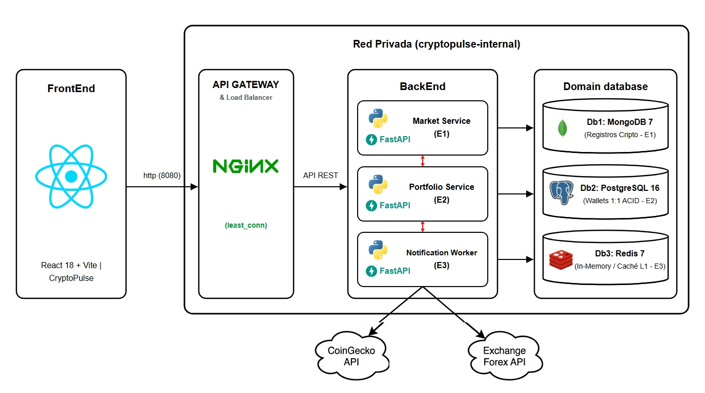
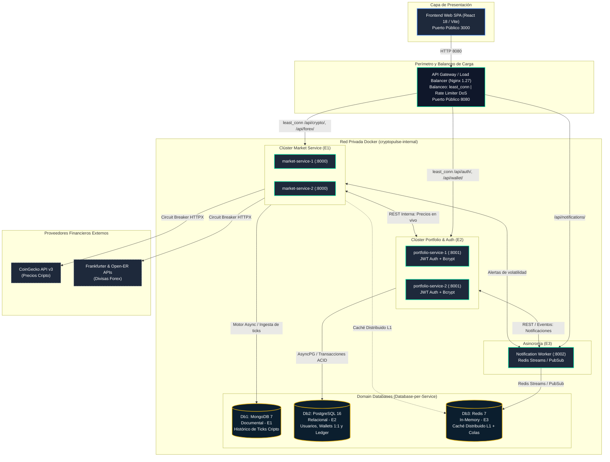
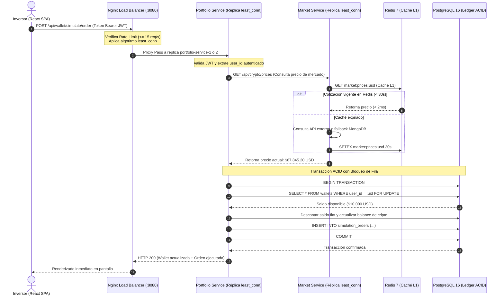

# Arquitectura del Sistema — CryptoPulse (Entrega 2)

Este documento describe de manera exhaustiva la arquitectura técnica de microservicios, la topología de clúster con balanceo de carga, la persistencia políglota (*Database-per-Service*), los mecanismos de resiliencia y el aseguramiento de calidad según la norma **ISO 9126** implementados en **CryptoPulse**.

---

## 1. Visión General del Sistema (Entrega 2)

**CryptoPulse** ha evolucionado hacia una plataforma financiera distribuida de alta disponibilidad con balanceo de carga perimetral, gestión de identidades segura, billeteras personales estrictamente aisladas (*1 usuario = 1 wallet privada*) y tolerancia a fallos mediante el patrón *Circuit Breaker*.

### Principios de Diseño Arquitectónico (Entrega 2)

1. **Balanceo de Carga y Clúster Multi-Instancia (Eficiencia):**
   - El API Gateway (Nginx 1.27) actúa como un balanceador de carga de Capa 7 (*Application Load Balancer*) distribuyendo el tráfico entre múltiples réplicas de los microservicios usando el algoritmo **`least_conn`** (asigna la solicitud a la instancia con menos conexiones concurrentes activas).
   - **Clúster Market Service:** Réplicas `market-service-1:8000` y `market-service-2:8000` para atender ráfagas de consultas de cotizaciones sin degradación.
   - **Clúster Portfolio Service:** Réplicas `portfolio-service-1:8001` y `portfolio-service-2:8001` para sesiones de usuario concurrentes y transacciones de billetera.
   - **Protección Perimetral DoS:** Directiva de *Rate Limiting* (`limit_req_zone`) en Nginx que previene ataques de denegación de servicio fijando una tasa máxima de 15 peticiones/segundo por IP con ráfaga (*burst*) controlada.

2. **Gestión de Identidad y Aislamiento Estricto de Billeteras (Seguridad e Integridad):**
   - **Autenticación Criptográfica:** Cifrado unidireccional de contraseñas con el estándar `bcrypt` y expedición de tokens de sesión **JWT (JSON Web Tokens)** firmados con algoritmo HS256.
   - **Garantía Inviolable de No Compartir Wallets:** En PostgreSQL 16, cada registro de la tabla `wallets` está sujeto a una restricción única `UNIQUE(user_id)`. Cada usuario registrado dispone de **su propia billetera virtual exclusiva**, dotada de un saldo inicial simulado de **$10,000 USD**. Ningún usuario puede visualizar, consultar ni debitar fondos de otra cuenta.
   - **Consistencia Transaccional ACID:** Toda simulación de compra o venta bloquea atómicamente la fila de la wallet (`with_for_update()`) para evitar condiciones de carrera (*race conditions*).

3. **Caché Distribuido y Resiliencia Circuit Breaker (Confiabilidad y Rendimiento):**
   - **Capa de Caché L1 en Redis 7:** Almacenamiento distribuido en memoria de cotizaciones y tasas con TTL de 30 segundos, reduciendo la latencia de respuesta a menos de 3 ms y blindando el sistema contra límites de cuota (*HTTP 429 Too Many Requests*) de las APIs externas.
   - **Patrón Cortacircuitos (*Circuit Breaker*):** Si CoinGecko o Frankfurter presentan 3 fallos consecutivos o latencias mayores a 10s, el circuito conmuta a estado `OPEN` y abastece automáticamente las cotizaciones más recientes almacenadas en **MongoDB 7**, garantizando una experiencia ininterrumpida al usuario.

4. **Patrón *Database-per-Service* Consolidado:**
   - **Db1: MongoDB 7 (Documental - E1):** Ingesta masiva y time-series de ticks y variaciones de precio de criptomonedas.
   - **Db2: PostgreSQL 16 (Relacional - E2):** Usuarios, billeteras aisladas, activos en posesión y libro mayor inmutable de órdenes simuladas.
   - **Db3: Redis 7 (In-Memory - E3):** Caché distribuido L1, colas FIFO (`LPUSH`) y canales Pub/Sub para alertas de mercado en tiempo real.

---

## 2. Diagrama de Arquitectura del Clúster (Mermaid)

---

## 3. Matriz de Componentes del Clúster

| Contenedor / Servicio | Imagen / Tecnología | Rol en el Clúster | Puertos Internos | Políticas de Escalado / Balanceo |
|---|---|---|---|---|
| `cryptopulse-frontend` | React 18, Vite 5, Nginx Alpine | SPA interactiva con Auth, Billetera Privada y Mercados | 80 (mapeado a 3000 host) | 1 contenedor público |
| `cryptopulse-gateway` | Nginx 1.27 Alpine | Balanceador de Carga Capa 7 y Proxy Inverso | 80 (mapeado a 8080 host) | Cluster `upstream` con `least_conn` y Rate Limiter |
| `market-service-1` | Python 3.12, FastAPI | Réplica A de ingesta y provisión de cotizaciones | 8000 | Balanceada por Nginx |
| `market-service-2` | Python 3.12, FastAPI | Réplica B de ingesta y provisión de cotizaciones | 8000 | Balanceada por Nginx |
| `portfolio-service-1`| Python 3.12, FastAPI | Réplica A de usuarios, JWT y billeteras aisladas | 8001 | Balanceada por Nginx |
| `portfolio-service-2`| Python 3.12, FastAPI | Réplica B de usuarios, JWT y billeteras aisladas | 8001 | Balanceada por Nginx |
| `notification-worker`| Python 3.12, FastAPI, Redis-py | Worker de tareas en background y despacho de alertas | 8002 | Suscriptor de colas Redis |
| `cryptopulse-mongodb` | MongoDB 7.0 Jammy | Almacén documental de cotizaciones e histórico | 27017 | Aislado en red privada (0 puertos host) |
| `cryptopulse-postgres`| PostgreSQL 16 Alpine | Almacén relacional ACID para usuarios y wallets | 5432 | Aislado en red privada (0 puertos host) |
| `cryptopulse-redis` | Redis 7 Alpine | Caché en memoria L1 y broker de mensajería | 6379 | Aislado en red privada (0 puertos host) |

---

## 4. Flujo de Datos: Simulación Concurrente con Balanceo de Carga

---

## 5. Alineación con Factores de Calidad ISO 9126

1. **Usabilidad:** Autenticación fluida con tokens JWT, persistencia de preferencias de usuario (moneda base, modo oscuro, favoritas) y retroalimentación instantánea de balance.
2. **Confiabilidad:** Patrón *Circuit Breaker* que commuta hacia el histórico de MongoDB 7 ante caídas de proveedores externos; health checks consolidados con métricas de latencia.
3. **Eficiencia:** Balanceo de cargas `least_conn` en Nginx reduciendo tiempos de espera; capa de caché distribuida en Redis 7 con respuestas en < 3 ms.
4. **Seguridad:** Cifrado de claves con `bcrypt`, tokens JWT temporales, aislamiento estricto de billeteras (1:1 no compartidas) y *Rate Limiting* en Nginx contra ataques de denegación de servicio.
5. **Mantenibilidad:** Arquitectura modular desacoplada, suite de pruebas automatizadas con `pytest` y pipeline de CI/CD con GitHub Actions.
