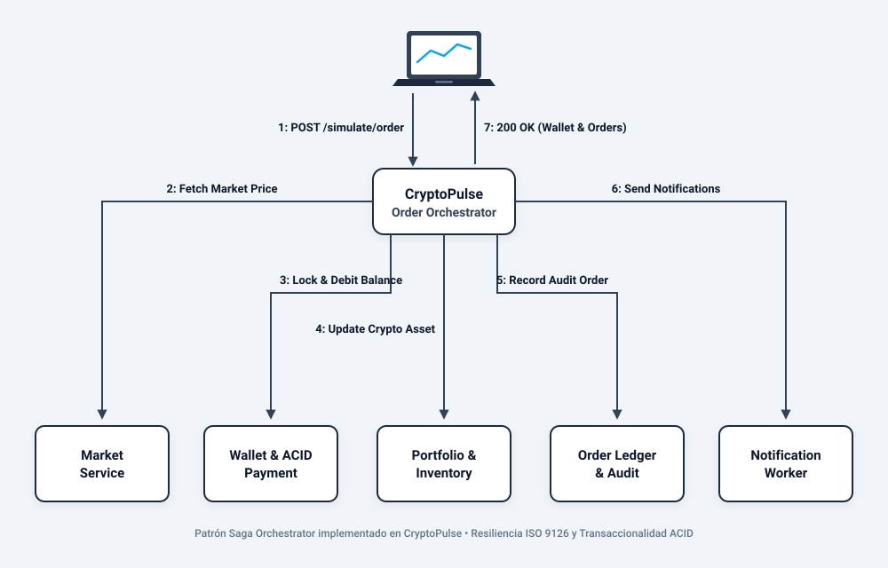
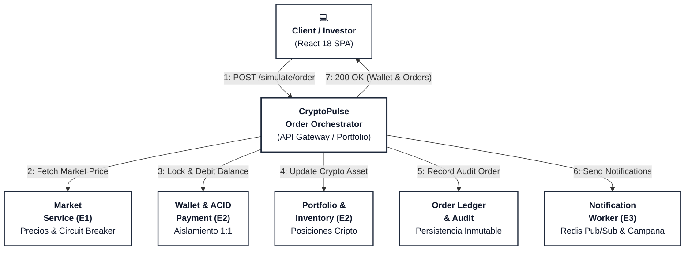

# Arquitectura de Orquestación y Alta Disponibilidad — CryptoPulse (Entrega Final)

Este documento describe formalmente la **arquitectura de orquestación**, la topología de clúster elástico, las políticas de resiliencia y el ciclo de vida de los servicios de **CryptoPulse** para la Entrega Final, cumpliendo con los estándares de la norma **ISO 9126 / ISO 25010** y las directrices de UNIMINUTO.

---

## 1. Diagrama de Orquestación Central (Patrón Saga Orchestrator)

Este diagrama representa el flujo orquestado de ejecución de órdenes y consultas en CryptoPulse, siguiendo el patrón de diseño centralizado (*Orchestration Pattern*):





---

## 2. Diagrama de Topología de Infraestructura del Clúster

```mermaid
graph TD
    classDef client fill:#0F172A,stroke:#38BDF8,stroke-width:2px,color:#FFFFFF;
    classDef gateway fill:#032830,stroke:#2DD4BF,stroke-width:2px,color:#FFFFFF;
    classDef control fill:#1E1B4B,stroke:#818CF8,stroke-width:2px,color:#FFFFFF;
    classDef service fill:#0B231A,stroke:#34D399,stroke-width:2px,color:#FFFFFF;
    classDef db fill:#2A1B0A,stroke:#FBBF24,stroke-width:2px,color:#FFFFFF;
    classDef broker fill:#3B0D0C,stroke:#F87171,stroke-width:2px,color:#FFFFFF;
    classDef external fill:#1E293B,stroke:#64748B,stroke-dasharray: 5 5,color:#FFFFFF;

    subgraph Internet["Zona de Acceso Público"]
        NAV["Navegador Cliente / Inversor<br/>(SPA React 18 + Vite)"]:::client
    end

    subgraph IngressGateway["Perímetro y Enrutamiento L7 (Port 8080 / 3000)"]
        GW["Nginx Load Balancer & Ingress Controller<br/>* Algoritmo least_conn<br/>* Rate Limiting DoS (15 req/s)<br/>* SSL / Cabeceras ISO 9126"]:::gateway
    end

    subgraph K8sCluster["Plano de Orquestación (Kubernetes / Docker Swarm HA)"]
        
        subgraph ControlPlane["Políticas y Resiliencia del Clúster"]
            HPA["Horizontal Pod Autoscaler (HPA)<br/>Autoescalado Elástico: 2 a 6 réplicas<br/>Umbral CPU > 70%"]:::control
            HC["Probes de Salud Activos<br/>* Liveness (Auto-Restart en fallo)<br/>* Readiness (Drenado de tráfico)"]:::control
        end

        subgraph ClusterMarket["Clúster Market Service (E1) — Autoescalado"]
            M1["Pod / Réplica: market-1 (:8000)<br/>FastAPI + Circuit Breaker"]:::service
            M2["Pod / Réplica: market-2 (:8000)<br/>FastAPI + Circuit Breaker"]:::service
            MN["Pod / Réplica N (Autoescalado)"]:::service
        end

        subgraph ClusterPortfolio["Clúster Portfolio & Auth (E2) — Autoescalado"]
            P1["Pod / Réplica: portfolio-1 (:8001)<br/>JWT HS256 + Bcrypt + ACID"]:::service
            P2["Pod / Réplica: portfolio-2 (:8001)<br/>JWT HS256 + Bcrypt + ACID"]:::service
        end

        subgraph AsynchronousLayer["Capa de Eventos y Notificaciones (E3)"]
            NW["Notification Worker (:8002)<br/>Despacho a Campana de Navbar"]:::service
        end

        subgraph DataTier["Capa de Persistencia Políglota (Database-per-Service)"]
            PG[("PostgreSQL 16 (StatefulSet)<br/>PVC: postgres-pvc (5Gi)<br/>* Usuarios y Wallets 1:1 Aisladas<br/>* Ledger Inmutable de Órdenes")]:::db
            MG[("MongoDB 7.0 (StatefulSet)<br/>PVC: mongodb-pvc (5Gi)<br/>* Time-series de Cotizaciones<br/>* Respaldo Local para Fallback")]:::db
            RD[("Redis 7 (In-Memory Broker)<br/>PVC: redis-pvc (2Gi)<br/>* Caché L1 (TTL 30s)<br/>* Colas de Notificaciones & PubSub")]:::broker
        end
    end

    subgraph ExternalFeeds["Proveedores Financieros Externos"]
        CG["CoinGecko API v3<br/>(Cotizaciones Cripto)"]:::external
        FK["Frankfurter API<br/>(Divisas Forex)"]:::external
    end

    %% Enrutamiento perimetral
    NAV -->|HTTP 3000 / 8080| GW
    GW -->|least_conn /api/crypto/, /api/forex/| ClusterMarket
    GW -->|least_conn /api/auth/, /api/wallet/| ClusterPortfolio
    GW -->|/api/notifications/| NW

    %% Orquestación y Control
    HPA -.->|Escala pods dinámicamente| ClusterMarket
    HPA -.->|Escala pods dinámicamente| ClusterPortfolio
    HC -.->|Monitorea /api/health| M1
    HC -.->|Monitorea /api/health| P1

    %% Comunicación inter-servicios
    ClusterPortfolio -->|GET precios en vivo| ClusterMarket
    ClusterPortfolio -->|POST eventos de órdenes| NW
    ClusterMarket -->|POST alertas de mercado| NW

    %% Acceso a Datos
    ClusterMarket -->|Ticks e histórico| MG
    ClusterMarket -->|Caché L1 (< 3ms)| RD
    ClusterPortfolio -->|Transacciones ACID con Bloqueo| PG
    NW -->|Colas FIFO y Pub/Sub| RD

    %% Resiliencia y Circuit Breaker
    ClusterMarket -->|HTTPX Circuit Breaker (OPEN / HALF_OPEN)| CG
    ClusterMarket -->|HTTPX Circuit Breaker| FK
    ClusterMarket -.->|Fallback automático si cae API| MG
```

---

## 2. Decisiones Clave de Orquestación y Justificación

### A. Estrategia de Dos Niveles: Docker HA + Kubernetes Nativo
Para garantizar máxima viabilidad y compatibilidad de ejecución en entornos académicos y de producción:
1. **Docker Compose de Producción (`docker-compose.yml` + `orchestrate.ps1`):**
   - Ideal para ejecución inmediata en Windows/Linux sin sobrecargar memoria de la máquina.
   - Cuenta con 2 réplicas balanceadas por servicio, políticas de reinicio `restart: unless-stopped`, dependencias por condición de salud (`condition: service_healthy`) y aislamiento perimetral mediante 2 redes virtuales (`cryptopulse-public` y `cryptopulse-internal`).
2. **Manifiestos de Kubernetes (`k8s/`):**
   - Configuración lista para entornos cloud o clústeres locales (Minikube / MicroK8s / Docker Desktop K8s).
   - Implementa `Namespace`, `ConfigMap`, `Secrets`, `PersistentVolumeClaims`, `Deployments` multi-réplica, `HorizontalPodAutoscaler` y sondas de salud (`livenessProbe` y `readinessProbe`).

### B. Matriz de Servicios Orquestados

| Pod / Servicio | Réplicas Base | Límites CPU | Límites RAM | Sonda Liveness | Estrategia de Persistencia |
|---|---|---|---|---|---|
| `gateway` | 1 | 250m | 128Mi | Nginx TCP / 80 | Stateless (ConfigMap / Nginx) |
| `frontend` | 1 | 200m | 128Mi | HTTP / 80 | Stateless (Vite Build) |
| `market-service` | 2 (Autoescalable a 6) | 500m | 384Mi | HTTP /api/health (10s) | Stateless + Redis L1 Cache |
| `portfolio-service` | 2 (Autoescalable a 5) | 500m | 384Mi | HTTP /api/health (10s) | Stateless + PostgreSQL ACID |
| `notification-worker` | 1 | 250m | 192Mi | HTTP /api/health (10s) | Stateless + Redis Streams |
| `postgres` | 1 | 500m | 512Mi | pg_isready (10s) | PVC: 5Gi (PostgreSQL 16) |
| `mongodb` | 1 | 500m | 512Mi | mongosh ping (10s) | PVC: 5Gi (MongoDB 7.0) |
| `redis` | 1 | 250m | 256Mi | redis-cli ping (10s) | PVC: 2Gi (Redis 7 AOF) |

---

## 3. Instrucciones de Ejecución

### Opción 1: Ejecución Inmediata mediante Script Orquestador
```powershell
# Iniciar clúster con auto-verificación
.\orchestrate.ps1 up

# Consultar salud de réplicas en tiempo real
.\orchestrate.ps1 health

# Ejecutar batería de pruebas de calidad (100% aprobadas)
.\orchestrate.ps1 test

# Detener clúster
.\orchestrate.ps1 down
```

### Opción 2: Despliegue en Kubernetes (Minikube / Docker Desktop)
```bash
# Aplicar todos los manifiestos en orden
kubectl apply -f k8s/00-namespace.yaml
kubectl apply -f k8s/01-config-secrets.yaml
kubectl apply -f k8s/02-storage.yaml
kubectl apply -f k8s/03-databases.yaml
kubectl apply -f k8s/04-microservices.yaml
kubectl apply -f k8s/05-gateway-frontend.yaml
kubectl apply -f k8s/06-hpa.yaml

# Verificar pods en ejecución
kubectl get pods -n cryptopulse
```
