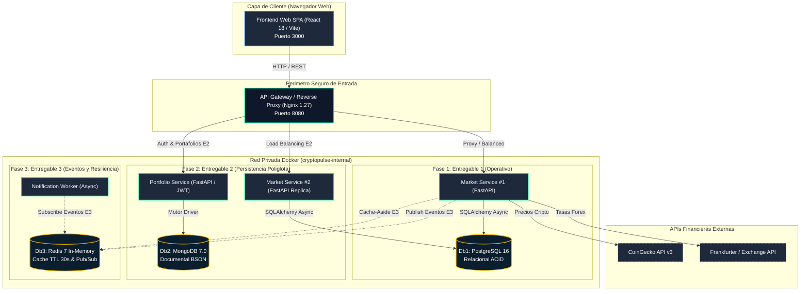

# CryptoPulse — Documento de Arquitectura del Sistema (3 Entregas)

Este documento detalla la arquitectura de software distribuida para las tres fases del proyecto CryptoPulse, correspondiente al modelo de microservicios, perimetro seguro y persistencia poliglota.

---

## 1. Diagrama de Bloques Global (3 Entregas)

---

## 2. Justificacion de la Persistencia Poliglota

| Base de Datos | Tipo | Rol en el Sistema | Razon de Seleccion |
|---|---|---|---|
| **PostgreSQL 16** | Relacional (ACID) | Historico transaccional de precios e indices | Garantiza integridad referencial estricta y precision para calculos monetarios. |
| **MongoDB 7.0** | NoSQL Documental (BSON) | Usuarios, carteras personalizadas y configuraciones | Flexibilidad para registrar portafolios con cantidades y tipos de activos variables por usuario. |
| **Redis 7** | In-Memory (Clave-Valor) | Cache de baja latencia (<1 ms) y bus Pub/Sub | Reduce llamadas a APIs externas respetando limites de tasa y distribuye eventos de alerta. |

---

## 3. Matriz de Entregables

1. **Entregable 1**: Frontend React + Gateway Nginx + Market Service FastAPI + PostgreSQL 16 en red privada.
2. **Entregable 2**: MongoDB 7.0 + Portfolio Service + Balanceo de carga Nginx en dos instancias backend.
3. **Entregable 3**: Redis 7 + Notification Worker + Circuit Breaker + Dashboard Grafana/Prometheus.
